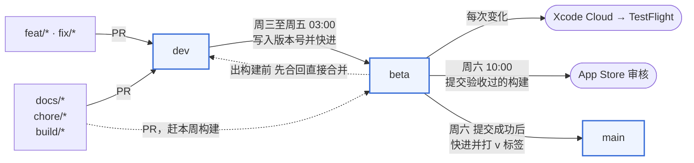

# 开发与验证

## 构建

最低部署版本为 iOS 18。使用支持工程当前 SDK 的 Xcode 打开 [Vime.xcodeproj](../Vime.xcodeproj)，选择 `Vime` scheme。首次构建需解析 SwiftPM 依赖，固定修订见 [Package.resolved](../Vime.xcodeproj/project.xcworkspace/xcshareddata/swiftpm/Package.resolved)。

安装到设备前，为主 App、`VimeKeyboard` 和所用测试 target 配置签名。App 与扩展须使用相同 App Group；当前标识为 `group.com.Voltline.Vime`。更换标识时同时核对 [App entitlements](../Configuration/Vime.entitlements)、[扩展配置](../Keyboard/Info.plist)、[设置存储](../Shared/Preferences/KeyboardPreferences.swift) 及引擎的共享容器配置。

模型资源随仓库提供。构建前可在仓库根目录运行：

```sh
python3 Scripts/validate_model_resources.py
```

该校验核对 manifest 身份、tokenizer 和完整 compiled model 文件集及 SHA256。Release 构建同样执行模型资源校验；资源缺失时应修复交付包，不能以运行时词典回退代替打包完整性。模型说明见 [日语模型](Models/JapaneseModel.md)。

App 的分组件许可与隐私政策可以用 `python3 Scripts/validate_app_resources.py` 校验，构建产物可传 `--resources <Vime.app>`，以检查声明原文和公开政策的一致性

## 本地化

App 与键盘支持简体中文（源语言）、繁体中文、日语、英语和韩语。界面文字统一放在 [Localizable.xcstrings](../Shared/Resources/Localizable.xcstrings)，由 App 与键盘扩展共用：

- SwiftUI 字面量（`Text`、`Button`、`Toggle`、`navigationTitle` 等）自动提取；自定义组件的文字参数使用 `LocalizedStringResource`，不要用 `String` 接收再交给 `Text`。
- 计算出的文字和 UIKit 标签使用 `String(localized:)`，整句作为一个 key，用插值代替字符串拼接，便于各语言调整语序。
- 同时作为逻辑标识的文字（如数字键盘的按键值、符号分组名、许可清单字段）保留中文原值作为 ID，显示时再用 `String(localized: String.LocalizationValue(...))` 查找；这类运行时 key 在目录中标记为 manual。
- 「変換 / 次候補 / 確定」等日语输入法惯用语在中文和日文界面保持原样，英文界面译为 Convert / Next / Confirm，韩文界面译为 변환 / 다음 후보 / 확정。

新增或修改文字后运行 `xcodebuild -exportLocalizations -project Vime.xcodeproj -scheme Vime -localizationPath <目录>` 同步目录，再补全四种语言的翻译。`python3 Scripts/validate_app_resources.py` 会拒绝任何未翻译的条目；带复数变体的条目还必须显式写出 zh-Hans 值，否则简体中文会回退到英文的复数形式。隐私政策按语言保存为 `Vime/Resources/PrivacyPolicy[-zh-Hant|-ja|-en|-ko].json`，公开文本由 `--write-policy` 生成，校验要求各语言日期和结构一致。

测试断言使用简体中文界面文字，共享 scheme 的测试语言固定为 `zh-Hans` / `CN`，不随模拟器系统语言变化。

## 测试层次

| 层次 | 覆盖范围 | 边界 |
| --- | --- | --- |
| `Tests/UIKit` | 原生引擎、候选排序、会话、宿主适配、学习及组件交互 | 内嵌组件通过不等于第三方宿主通过 |
| `Tests/ExtensionUI` / `VimeExtensionTests` | iOS 实际加载的键盘扩展 | 模拟器不能证明真机内存、能耗或所有 App 的行为 |
| 真机手动验证 | 第三方宿主、连续输入、光标变化、反馈和性能 | 记录输入串、操作步骤、版本及宿主，避免只记录最终截图 |

主 App 首页的试打框使用正常系统输入框，添加 Vime 后用地球键切换，才会加载键盘扩展。「设置 → 问题诊断」提供真实键盘扩展的待确认文本观察和记录入口。`Vime/Sandbox` 的内嵌 `KeyboardView` 适合组件开发，不代替上述路径。

分段输入应验证整个过程：点击前段后，正文只增加已选文字，后段仍保持 marked text；继续选后段、退格、移光标和切换字段时，检查正文中没有重复插入或意外确认尾部。候选栏和完整候选菜单都要覆盖。

## 日常测试

开发时用 [test.sh](../Scripts/test.sh)。它固定使用一个构建目录做增量构建，模拟器默认取已启动的那台，没有就取第一台 iPhone，也可以用 `VIME_SIMULATOR` 指定名称或 UDID：

```sh
bash Scripts/test.sh                                   # 全部单元测试
bash Scripts/test.sh KeyboardFeatureTests KeyboardCoreTests/testRomajiAndVisibleKanaDeletion
bash Scripts/test.sh --failed                          # 只重跑上次失败的用例
bash Scripts/test.sh --extension                       # 真实键盘扩展的 UI 测试
```

结束时按结果包汇总通过、失败和跳过的数量，并列出失败用例；完整输出在构建目录的 `Results/` 下。需要留存证据时改用下文的 `verify_review.sh`。

`--` 之后的参数原样交给 xcodebuild。合并到 dev 或 beta 的 PR 由 [Unit tests](../.github/workflows/unit-tests.yml) 工作流在 GitHub 的 `xcode-27` runner 上跑同样的单元测试：跳过尚未达到的模型预期 `testOrthographyAndSupplementalDictionaryAreSelectable`，失败的用例重试一次；只改文档的 PR 不跑。扩展 UI 测试需要在系统设置里启用键盘，只在本机跑。

## 可复现检查

[verify_review.sh](../Scripts/verify_review.sh) 支持 `focused`、`full`、`extension`、`all`。显式指定模拟器和已经解析好的依赖缓存，例如：

```sh
export VIME_TEST_DESTINATION='platform=iOS Simulator,id=<SIMULATOR_UDID>'
export VIME_PACKAGE_CACHE='<PATH_TO_RESOLVED_SOURCE_PACKAGES>'
bash Scripts/verify_review.sh all
```

输出默认保存到独立临时目录；也可用 `VIME_REVIEW_OUTPUT` 指定新的本地证据目录，不能覆盖旧结果。`VIME_DERIVED_DATA` 可指定构建缓存，`VIME_SWIFT_OPTIMIZATION` 可选 `-Onone` 或 `-O`。保存长期排查材料时放入 `Docs/internalDocs/Evidence/`。

脚本保存源码与资源快照、命令、退出码和 XCTest 结果，检查预期测试方法是否实际被发现及执行。失败、缺失用例或非预期跳过均不算通过。两个 benchmark 和内存场景默认按需运行，其跳过不构成性能验证；CPU_ONLY 模型不能因测试名称含 Neural Engine 就视为已支持其他计算设备。

测试预期应独立于被测实现。模型参考输出与 corpus 随测试版本维护，不能为通过测试而把预期改成当前错误输出。出现失败要保留输入、命令和失败结果，再补充修复后的证据。

## 排查键盘退出

键盘被切回系统输入法不一定代表 Swift 崩溃，也可能是系统因内存压力终止扩展，或宿主进入不支持第三方键盘的输入框。先记录设备、系统版本、构建号、宿主 App 和发生时间，再核对设备上的 `VimeKeyboard` 崩溃报告与同一时段的 `JetsamEvent`。Jetsam 报告中出现 Vime 的进程名不等于它被终止，必须核对该进程对应的终止原因，不能用主 App 或模拟器的旧崩溃代替扩展证据

扩展使用 `com.Voltline.Vime` / `ExtensionLifecycle` 系统日志记录加载、显示、隐藏和内存警告，字段只有 PID、控制器存活时间与物理内存占用，不包含输入文本。`LanguageModel` 类别记录模型加载和推理状态，采集日志时按发生时间与进程核对

候选工作队列在每个任务结束时释放 autorelease 临时对象。收到 UIKit 内存警告后，扩展取消旧请求，在同一工作队列释放模型与临时候选缓存，并清理闲置 UI；当前组合、选中候选、分段范围及待确认学习反馈保留。未完成的基础候选请求会重新发起，神经排序与神经联想暂停，继续使用词典能力。普通按键与宿主切换不会立即重新加载模型；将排序切到词典再切回模型可显式重试，扩展进程重建后也可重试

内存警告不保证在系统终止前送达，已经进入的 Core ML 推理也不能被立即中断。模拟器的物理内存采样仅用于观察趋势，不能证明真机扩展未触及系统限制，也不能据此给出固定内存上限。报告格式和终止原因见 [Apple 的 Jetsam 排查说明](https://developer.apple.com/documentation/xcode/identifying-high-memory-use-with-jetsam-event-reports)

定向回归用例为 `KeyboardMemoryPressureTests`，覆盖加载过的模型释放、避免反复加载、异步候选重发、未完成罗马字以及分段选择保持。`VimeLanguageModelMemoryTests/testProcessMemoryProfile` 需显式设置 `TEST_RUNNER_VIME_MEMORY_SCENARIO=lm_words`，确认执行和联想发布次数后再解读内存数据。实际扩展路径另用 `KeyboardExtensionTests/testExpandedPartialSelectionKeepsHostMarkedRange` 验证，不能把模拟内存警告测试表述为真实 Jetsam 验收

## 分支与发布



实线是每周的常规路径，虚线只在 `docs/` `chore/` `build/` 直接合入 `beta` 时出现。

| 分支 | 用途 | 更新方式 |
| --- | --- | --- |
| `feat/<名称>` / `fix/<名称>` | 功能或修复 | 从 `dev` 切出，开 PR 合入 `dev` |
| `docs/<名称>` / `chore/<名称>` / `build/<名称>` | 文档、维护、构建配置 | 通常合入 `dev`；需要赶上本周构建时可从 `beta` 切出并合入 `beta` |
| `dev` | 集成分支，GitHub 默认分支 | 上述 PR；版本号提交与 `beta` 回合由周三至周五的流程写入 |
| `beta` | 本周 TestFlight 构建 | 周三至周五由流程快进到 `dev`；平时只接受 `docs/` `chore/` `build/` PR |
| `main` | 已提交审核的版本 | 周六由流程快进到 `beta`，并打 `v<版本>` 标签 |

前缀之后只用小写字母、数字及 `.` `_` `-`，例如 `feat/emoji-search`、`fix/long-input-correction`。PR 由 [Branch policy](../.github/workflows/branch-policy.yml) 检查目标分支与命名，`main` 不接受 PR。合并使用 merge commit，合并后删除源分支。提交说明沿用 `feat: …` / `fix: …` 等前缀，版本号据此计算。

`main` 始终是 `beta` 的祖先，`main` 与 `beta` 只做快进。直接合入 `beta` 的提交由下一次出构建的流程合回 `dev`，之后 `beta` 才能再次快进；合回出现冲突时任务失败，开 `chore/sync-beta` PR 把 `beta` 合入 `dev` 解决后重新运行。

### 每周节奏（北京时间）

1. **随时**：改动合入 `dev`。要进入本周版本的改动在周五 03:00 之前合并；周四 03:00 之后合入的改动只能在周五的构建上验收一天。
2. **周三至周五 03:00**：[Weekly TestFlight cut](../.github/workflows/weekly-testflight.yml) 每天运行一次。它先把 `beta` 上的直接合并合回 `dev`，再检查 `dev` 是否有 `beta` 之外的提交（不计合并提交）。有则在 `dev` 写入营销版本、快进 `beta`，并创建或更新草稿 Release `v<版本>`；没有则当天不出构建。`beta` 的变化触发 Xcode Cloud 的 TestFlight workflow，archive 后上传 TestFlight。
3. **周三至周五**：在最新的 TestFlight 构建上做真机验收（见「测试层次」），通过后把它的构建号填在草稿 Release 的「验收构建」后，并填写更新说明（见下文「更新说明」）。出构建的任务每次运行都会清空「验收构建」，需要在新构建上重新验收。这期间直接合入 `beta` 的 `build/` 等改动同样会触发新构建，同属本周版本；它们不改写草稿，但周六的检查只接受最新的构建，所以同样要在新构建上验收后更新「验收构建」。发现阻断问题时不填「验收构建」（或删除草稿 Release），周六任务停止，本周不提交；修复照常走 `fix/` → `dev`，在下一次出构建时带上。
4. **周六 10:00**：[Weekly App Store release](../.github/workflows/weekly-release.yml) 在 `beta` 领先 `main` 时，提交「验收构建」指定的构建。提交前先做一次只读检查（见下文「提交前检查」）：该构建必须是此版本最新的已处理构建，且上传时间晚于 `beta` 最新提交，否则不提交。检查通过后提交审核，快进 `main`、打标签并发布 Release。审核通过后自动上架（`AUTOMATIC_RELEASE`）。若该版本已有标签，说明领先的只是提交审核后才合入 `beta` 的改动：此时只快进 `main`，不再提交，这些改动随下一个版本发布。

两个任务都可以在 Actions 页面手动运行，用于计划外的构建或补交。周六任务手动运行时可以关闭 `submit`，只推进 `main` 与标签，例如审核已在 App Store Connect 手动提交时。

### 更新说明

App Store 每次提交更新都要求各语言的「此版本的新增内容」。这些文字不进仓库，写在本周第一次出构建时生成的草稿 Release 中：在 `zh-Hans`、`zh-Hant`、`ja`、`en-US`、`ko` 标题下各写一段，`---` 以下是自动生成的 PR 列表，仅供参考，不会提交。周六任务读取这五段，任一缺失则不提交。之后每次出构建，已填写的五段都会保留，PR 列表更新，「验收构建」清空。若新合入的功能让版本号从修订号升为次版本（例如 1.1.1 → 1.2），旧版本的草稿会被删除，已填写的内容搬到新版本的草稿中。

草稿只在出构建的任务运行时更新。周五 03:00 之后合入 `dev` 的改动属于下周版本，不会出现在本周草稿中；直接合入 `beta` 的改动会触发新的 TestFlight 构建，但不会改写草稿。若这些改动需要用户知道，手动补进对应语言的段落。周六发布 Release 时，`---` 以下的 PR 列表按上一个标签到新标签重新生成，因此会包含这些直接合并。

### 提交前检查

[App Store check](../.github/workflows/app-store-check.yml) 只读取 App Store Connect，不做任何修改，可在 Actions 页面随时手动运行，例如周五确认周六能否提交。它读取 `beta` 的营销版本，报告：

- App Store Connect 中各版本的状态，以及是否有其他版本仍在审核或等待上架；
- 版本的本地化语言是否正好是更新说明的五种语言；
- 该版本是否有已处理（`VALID`）且未过期的构建；
- 草稿 Release 中哪些语言的更新说明已经填写；
- 「验收构建」是否填写，是否就是最新的已处理构建，以及该构建是否在 `beta` 最新提交之后上传。

结果写在运行摘要中。语言不符、没有可用构建或 API 失败时运行失败；其他版本仍在审核、说明未填写、验收构建缺失或过时只给出警告。周六任务在提交前以严格模式运行同一检查，警告也会阻止提交。检查脚本是 [app_store.py](../.github/scripts/app_store.py)，App Store Connect 中的语言变化时同步修改其中的 `LOCALES`。

### 版本号

- **营销版本**（`MARKETING_VERSION`）由 [release_version.py](../Scripts/release_version.py) 计算，以 `main` 上最近的 `v*` 标签为基准：其后有 `feat` 提交或 `feat/` 分支合并时升次版本（1.1 → 1.2），否则升修订号（1.1 → 1.1.1）。`dev` 上已经升过而尚未发布的版本保持不变，所以跳过一周不会重复升级；若之后出现新功能，修订号会改为次版本。主版本号只能手动修改：在 PR 中把各 target 的 `MARKETING_VERSION` 改为新值，脚本不会降低它。`python3 Scripts/release_version.py current` 显示当前版本，`next --base-ref origin/main` 预览下一版本。
- **构建号**由 Xcode Cloud 在 archive 时设置，按 App Store Connect 已接收的构建递增；工程中的 `CURRENT_PROJECT_VERSION` 只用于本地构建，不需要手动修改。

### 一次性配置

以下设置在仓库或 App Store Connect 中完成，不由脚本修改：

- **分支**：从 `main` 创建 `dev` 与 `beta`，把仓库默认分支设为 `dev`。定时 workflow 只从默认分支读取，因此 `.github/workflows` 必须先合入 `dev`。在 `main` 的 `fed1eb3`（1.0 的提交）上打 `v1.0`，作为第一个基准标签。
- **分支规则（Rulesets）**：三个分支都禁止强推和删除。`dev` 与 `beta` 要求 PR（只允许 merge commit）与 `branch-policy` 检查通过；`main` 禁止直接更新。个人仓库不能把 GitHub Actions 加入绕过名单，因此绕过名单是部署密钥（Deploy keys）：周任务用有写权限的 `vime-release` 部署密钥推送，用于写入版本号、合回 `beta` 和快进分支。仓库中不要添加其他部署密钥，否则它们同样可以绕过规则。
- **Secrets**：`RELEASE_DEPLOY_KEY`（上述部署密钥的私钥），以及 `ASC_KEY_ID`、`ASC_ISSUER_ID`、`ASC_PRIVATE_KEY`（App Store Connect API 密钥，App Manager 角色，私钥填 `.p8` 文件全文，仅供周六提交审核使用）。
- **Xcode Cloud**：TestFlight workflow 的启动条件设为 `beta` 分支变化，并在文件条件中忽略 `Docs/`、`.github/` 与 `*.md`，避免纯文档合并触发构建；archive 后分发到 TestFlight。停用基于 `main` 的定时构建。

### 审核异常

- **提交失败**（上周版本仍在审核、缺少更新说明或密钥）：任务失败并由 GitHub 邮件通知，`main` 与标签不动。处理后手动运行周六任务；若下周的构建先出且没有新功能，版本号保持不变，只换成新构建。
- **审核被拒**：该版本已打标签。修复走 `fix/` → `dev`，下周按新的修订号出构建，周六提交时 App Store Connect 中被拒的版本改用新版本号。需要更快重新提交时，手动运行出构建的任务，验收并填写「验收构建」后再手动运行周六任务。

## 网站

项目网站 <https://voltline.github.io/Vime/> 由 [site/build.py](../site/build.py) 生成静态页面，[Website](../.github/workflows/website.yml) workflow 部署到 GitHub Pages（来源为 GitHub Actions），不需要第三方依赖。

| 页面 | 内容来源 |
| --- | --- |
| 首页 `/<语言>/` | `site/content/<语言>.json`，文字取自各语言 README；繁体中文按台湾用语改写 |
| 隐私政策 `/<语言>/privacy/` | `main` 上的 `Docs/Guides/Privacy*.md`，即已发布版本的政策 |
| 更新日志 `/<语言>/changelog/` | 已发布的 GitHub Release 中对应语言的段落（`---` 以上），跳过草稿；缺少该语言时显示英文 |

语言为 `zh-hans`、`zh-hant`、`ja`、`en`、`ko`。根路径以及 `/privacy/`、`/changelog/` 按浏览器语言或上次选择的语言跳转，可以作为 App Store 的隐私政策和营销网址。

更新日志页顶部的版本状态在构建时读取：App Store 上架版本来自公开的 iTunes lookup；审核中的版本与状态、最新 TestFlight 版本和构建号用 `ASC_*` Secrets 经 [app_store.py](../.github/scripts/app_store.py) 读取 App Store Connect；`dev` 上的下一版本来自 `release_version.py current`；另列出每周节奏和下次构建、提交的时间。页面只包含版本、状态和日期。缺少密钥或 API 失败时只给出警告，网站照常构建，只显示公开部分。

Workflow 总是构建 `dev` 上的 `site/`，在以下情况运行：`dev` 上修改网站的推送；出构建和周六任务结束后；每天北京时间 05:00（此时当天的 TestFlight 构建已上传）；以及手动运行。`main` 只由周六任务推进，所以周六任务结束后的构建会带上新的隐私政策。部署环境 `github-pages` 只允许 `dev` 部署，因此 workflow 不在 `main` 的推送上运行。

本地预览：

```bash
python3 site/build.py --out /tmp/vime-site/Vime --base-url http://localhost:8000/Vime/
```

```bash
python3 -m http.server 8000 --directory /tmp/vime-site
```

修改网站文字时同步修改五种语言的 JSON。

## 发布检查

- 营销版本与构建号按「分支与发布」自动计算；提交前在 App Store Connect 核对所选构建与 `beta` 提交一致。
- 核对 App / 扩展签名、App Group、版本、资源清单及 [隐私声明](../Shared/Resources/PrivacyInfo.xcprivacy)。
- 对最终构建执行对应测试并验收真正键盘扩展；不能把历史报告或旧构建的通过结果当作当前 archive 的证明。
- 确认模型 preflight 和 Release archive 成功，再进行分发。签名凭据与 App Store Connect 密钥只保存在 Xcode Cloud 和仓库 Secrets，不写入脚本或文档。
