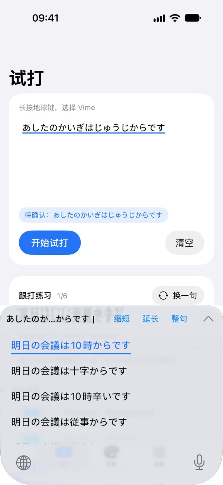
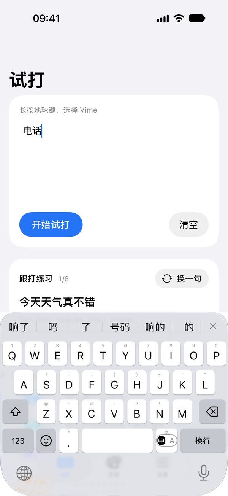
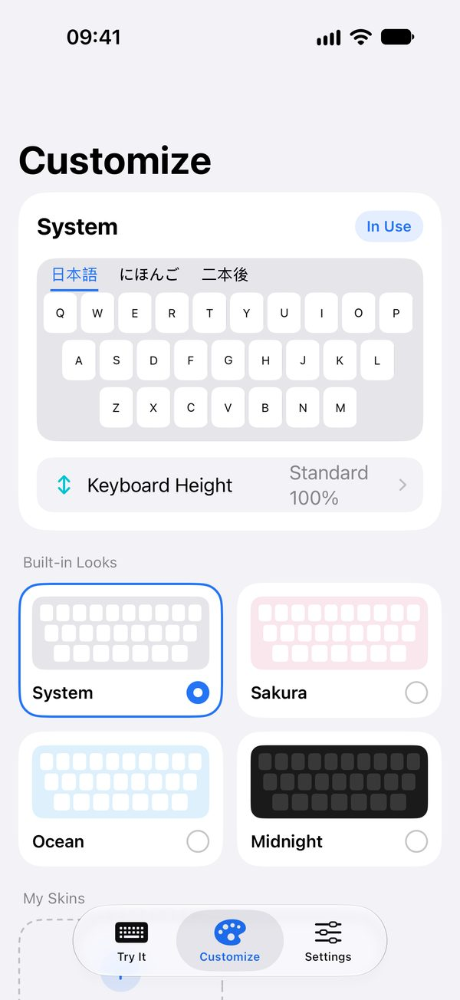

# Vime

A fully offline multilingual keyboard for iOS

<a href="../../README.md">简体中文</a> · <a href="README.zh-Hant.md">繁體中文</a> · <b>English</b> · <a href="README.ja.md">日本語</a> · <a href="README.ko.md">한국어</a>

Japanese, Chinese and English in one keyboard. On-device models rank candidates, fix typos and suggest the next word, so what you type never leaves your phone.

  
  
  

## Features

- **Japanese**: romaji QWERTY or the kana 12-key layout, whole-sentence and segment conversion, and live conversion; Chinese pinyin also finds Japanese kanji words.
- **Chinese**: pinyin input built on librime, with sentence input, initials-only abbreviations, fuzzy pinyin and typo correction, in simplified or traditional characters.
- **English**: direct input with word completion; swipe up on the language key to switch languages.
- **On-device language models**: a small model each for Japanese and Chinese ranks candidates by context and suggests the next word.
- **Tools**: user dictionaries, clipboard suggestions, calculations on the number page, and a panel of symbols, emoji and kaomoji.
- **Personalization**: built-in looks and custom skins, with adjustable keyboard height, key sounds and haptics.

## Privacy

Conversion, correction, learning and suggestions all happen on the device. Vime contains no networking code and never uploads what you type or copy. Basic typing does not need Allow Full Access. See the [privacy policy](../../Docs/Guides/Privacy.en.md).

## Building from source

Requires iOS 18 or later and an Xcode that supports the current SDK. Open [Vime.xcodeproj](../../Vime.xcodeproj) in Xcode and choose the `Vime` scheme; before running on a device, set up signing and the same App Group for the app and the `VimeKeyboard` extension. Building, testing and releasing are described in the [development guide](../../Docs/Development.md).

## Documentation

Guides, architecture notes and the development workflow are listed in the [documentation index](../../Docs/README.md).

## License and acknowledgements

Vime is released under [GPL-3.0-or-later](../../LICENSE), with an additional permission under GPLv3 section 7 that allows distribution through app stores such as the App Store as long as the Corresponding Source is offered; see [LICENSE-EXCEPTION](../../LICENSE-EXCEPTION). Versions before 2026-10-22 were released under GPL-2.0-only. The bundled [VimeML](https://github.com/Voltline/VimeML) Japanese model uses the same license; its training data attribution is in the third-party notices. Kana-kanji conversion uses [AzooKeyKanaKanjiConverter](https://github.com/azooKey/AzooKeyKanaKanjiConverter), and tokenization uses [SentencePiece](https://github.com/google/sentencepiece). Chinese input uses [librime](https://github.com/rime/librime) and [OpenCC](https://github.com/BYVoid/OpenCC); the pinyin dictionary contains CC BY-SA 4.0 data and is distributed under the same license. Licenses, acknowledgements and sources for third-party code and data are in [ThirdPartyNotices.txt](../../Shared/Resources/ThirdPartyNotices.txt), the [SentencePiece LICENSE](../../Dependencies/VimeSentencePiece/LICENSE) and the [language resource sources](../../Shared/Resources/LanguageResourceSources.json). The full texts are also available in the app under Settings → About Vime → Open Source Licenses.
