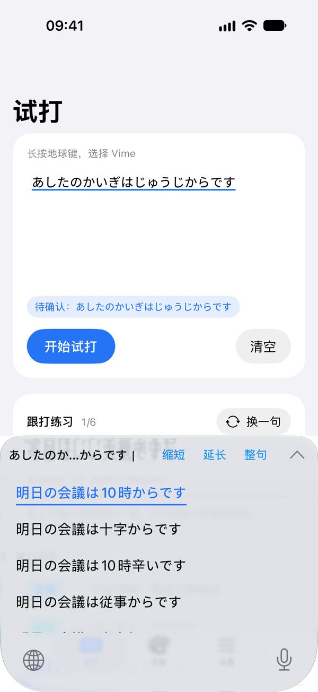
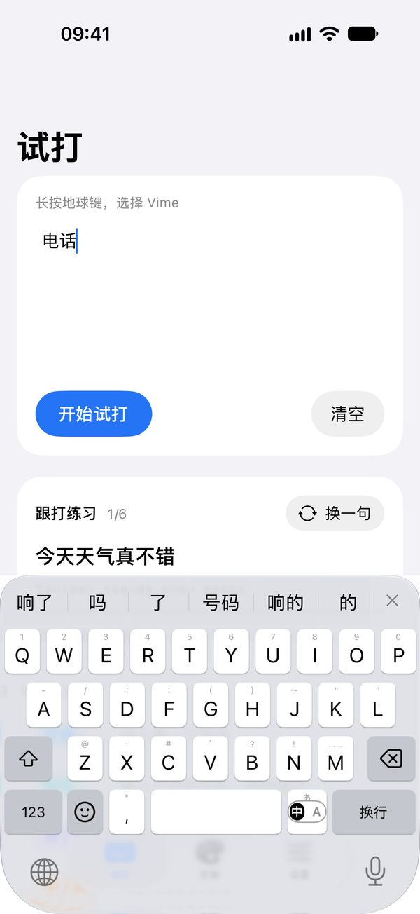
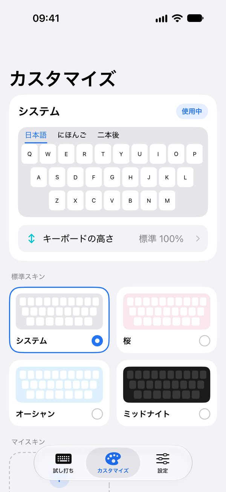

# Vime

完全オフラインで動く iOS の多言語キーボード

<a href="../../README.md">简体中文</a> · <a href="README.zh-Hant.md">繁體中文</a> · <a href="README.en.md">English</a> · <b>日本語</b> · <a href="README.ko.md">한국어</a>

日本語、中国語、英語をひとつのキーボードで。候補の並べ替え、誤入力補正、予測は端末上のモデルが行い、入力内容が外に出ることはありません。

  
  
  

## 機能

- **日本語**：ローマ字 QWERTY とかなフリック／トグル入力、文全体と文節ごとの変換、ライブ変換。中国語のピンインでも日本語の漢字語を探せます。
- **中国語**：librime をもとにしたピンイン入力。文単位の入力、頭文字だけの簡略入力、あいまい音、ピンインの誤入力補正、簡体字と繁体字の切り替えに対応。
- **英語**：単語補完付きの直接入力。言語キーを上にスワイプして言語を切り替えられます。
- **端末内の言語モデル**：日本語と中国語それぞれの小さなモデルが、文脈に合わせて候補を並べ替え、次の語を予測します。
- **便利な機能**：ユーザー辞書、クリップボードの候補表示、数字ページでの計算、記号・絵文字・顔文字パネル。
- **カスタマイズ**：内蔵の外観と自作スキン。キーボードの高さ、キー音、振動も調整できます。

## プライバシー

変換、誤入力補正、学習、予測はすべて端末上で行われます。Vime には通信を行うコードがなく、入力内容やクリップボードを送信しません。基本的な入力には「フルアクセスを許可」は不要です。詳しくは[プライバシーポリシー](../../Docs/Guides/Privacy.ja.md)をご覧ください。

## ソースからのビルド

iOS 18 以降と、現在の SDK に対応した Xcode が必要です。Xcode で [Vime.xcodeproj](../../Vime.xcodeproj) を開き、`Vime` スキームを選びます。実機で動かす前に、本体アプリと `VimeKeyboard` 拡張に署名と同じ App Group を設定してください。ビルド、テスト、リリースの手順は[開発ガイド](../../Docs/Development.md)にあります。

## ドキュメント

使い方、設計、開発の流れは[ドキュメント一覧](../../Docs/README.md)にまとめています。

## ライセンスと謝辞

Vime は [GPL-3.0-or-later](../../LICENSE) で公開しており、GPLv3 第 7 条に基づく追加許可として、対応するソースコードを提供することを条件に App Store などのアプリストアでの配布を認めています（[LICENSE-EXCEPTION](../../LICENSE-EXCEPTION)）。2026-10-22 より前のバージョンは GPL-2.0-only です。同梱の日本語モデル [VimeML](https://github.com/Voltline/VimeML) も同じライセンスで、学習データの帰属表示はサードパーティ通知に記載しています。かな漢字変換には [AzooKeyKanaKanjiConverter](https://github.com/azooKey/AzooKeyKanaKanjiConverter)、トークナイズには [SentencePiece](https://github.com/google/sentencepiece) を使用しています。中国語入力には [librime](https://github.com/rime/librime) と [OpenCC](https://github.com/BYVoid/OpenCC) を使用しており、ピンイン辞書は CC BY-SA 4.0 のデータを含むため同じライセンスで配布しています。サードパーティのコードとデータのライセンス、謝辞、出典は [ThirdPartyNotices.txt](../../Shared/Resources/ThirdPartyNotices.txt)、[SentencePiece LICENSE](../../Dependencies/VimeSentencePiece/LICENSE)、[言語リソースの出典一覧](../../Shared/Resources/LanguageResourceSources.json) にまとめています。アプリ内の「設定 → Vime について → オープンソースとライセンス」でも全文を確認できます。
