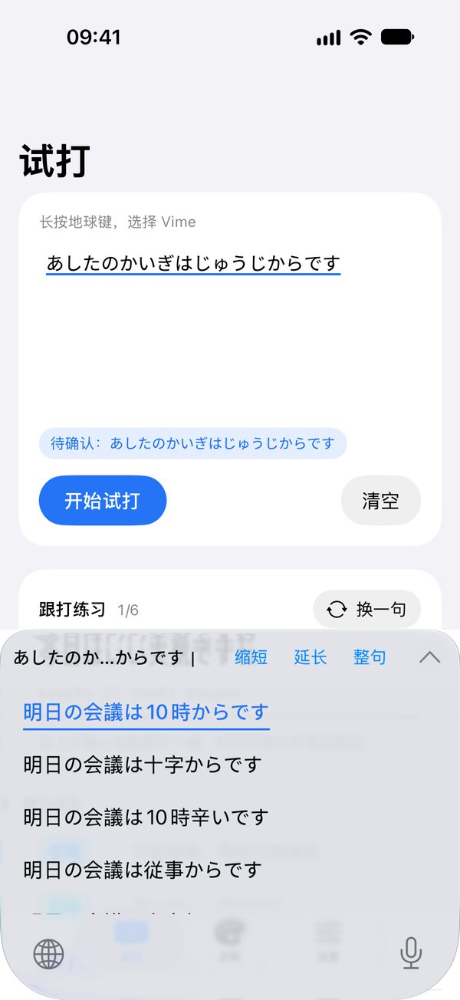
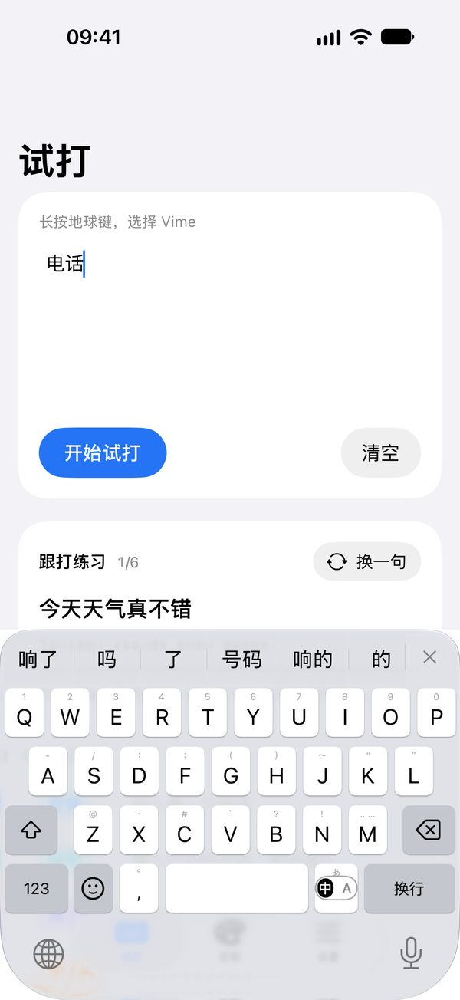
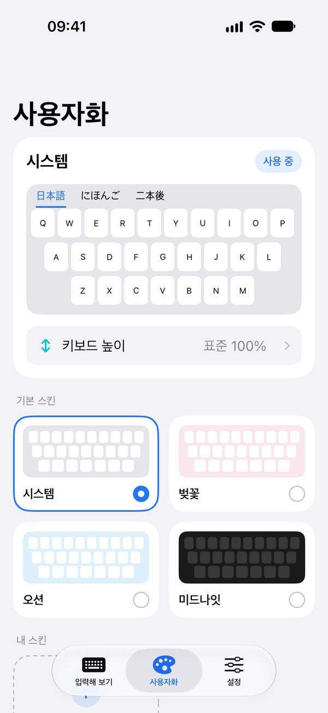

# Vime

완전히 오프라인으로 동작하는 iOS 다국어 키보드

<a href="../../README.md">简体中文</a> · <a href="README.zh-Hant.md">繁體中文</a> · <a href="README.en.md">English</a> · <a href="README.ja.md">日本語</a> · <b>한국어</b>

일본어, 중국어, 영어를 키보드 하나로. 후보 정렬, 오타 교정, 다음 단어 제안은 기기 내 모델이 처리하므로 입력 내용이 휴대폰 밖으로 나가지 않습니다.

  
  
  

## 기능

- **일본어**: 로마자 QWERTY 또는 가나 12키 배열, 문장 전체와 구간별 변환, 실시간 변환. 중국어 병음으로도 일본어 한자 단어를 찾을 수 있습니다.
- **중국어**: librime 기반 병음 입력. 문장 입력, 초성만 입력하는 약어, 퍼지 병음, 오타 교정, 간체·번체 전환을 지원합니다.
- **영어**: 단어 자동 완성이 있는 직접 입력. 언어 키를 위로 밀어 언어를 전환합니다.
- **기기 내 언어 모델**: 일본어와 중국어용 작은 모델이 문맥에 맞게 후보를 정렬하고 다음 단어를 제안합니다.
- **편의 기능**: 사용자 사전, 클립보드 제안, 숫자 페이지 계산, 기호·이모지·이모티콘 패널.
- **개인화**: 기본 테마와 직접 만드는 스킨, 키보드 높이·키 소리·진동 조절.

## 개인정보

변환, 오타 교정, 학습, 제안은 모두 기기에서 처리됩니다. Vime에는 네트워크 코드가 없으며 입력 내용이나 클립보드를 전송하지 않습니다. 기본 입력에는 「전체 접근 허용」이 필요하지 않습니다. 자세한 내용은 [개인정보 처리방침](../../Docs/Guides/Privacy.ko.md)을 참고하세요.

## 소스에서 빌드하기

iOS 18 이상과 현재 SDK를 지원하는 Xcode가 필요합니다. Xcode에서 [Vime.xcodeproj](../../Vime.xcodeproj)를 열고 `Vime` 스킴을 선택하세요. 실제 기기에서 실행하기 전에 앱과 `VimeKeyboard` 확장 프로그램에 서명과 같은 App Group을 설정해야 합니다. 빌드, 테스트, 배포 절차는 [개발 가이드](../../Docs/Development.md)에 있습니다.

## 문서

사용 가이드, 구조 설명, 개발 절차는 [문서 목록](../../Docs/README.md)에 정리되어 있습니다.

## 라이선스와 감사의 말

Vime은 [GPL-3.0-or-later](../../LICENSE)로 배포되며, GPLv3 제7조에 따른 추가 허가로 대응하는 소스 코드를 함께 제공하는 조건에서 App Store 등 앱 스토어를 통한 배포를 허용합니다([LICENSE-EXCEPTION](../../LICENSE-EXCEPTION) 참고). 2026-10-22 이전 버전은 GPL-2.0-only로 배포되었습니다. 함께 포함된 일본어 모델 [VimeML](https://github.com/Voltline/VimeML)도 같은 라이선스를 따르며, 학습 데이터의 저작자 표시는 서드파티 고지에 있습니다. 가나 한자 변환에는 [AzooKeyKanaKanjiConverter](https://github.com/azooKey/AzooKeyKanaKanjiConverter)를, 토큰화에는 [SentencePiece](https://github.com/google/sentencepiece)를 사용합니다. 중국어 입력에는 [librime](https://github.com/rime/librime)과 [OpenCC](https://github.com/BYVoid/OpenCC)를 사용하며, 병음 사전은 CC BY-SA 4.0 데이터를 포함하므로 같은 라이선스로 배포합니다. 서드파티 코드와 데이터의 라이선스, 감사의 말, 출처는 [ThirdPartyNotices.txt](../../Shared/Resources/ThirdPartyNotices.txt), [SentencePiece LICENSE](../../Dependencies/VimeSentencePiece/LICENSE), [언어 리소스 출처 목록](../../Shared/Resources/LanguageResourceSources.json)에 정리되어 있으며, 앱의 「설정 → Vime에 관하여 → 오픈 소스 라이선스」에서도 전문을 볼 수 있습니다.
