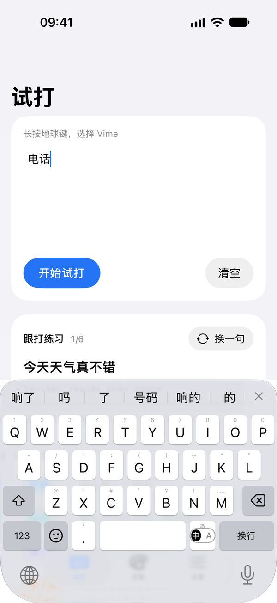
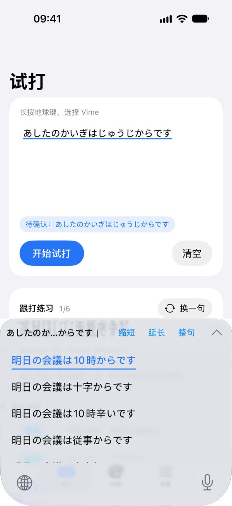
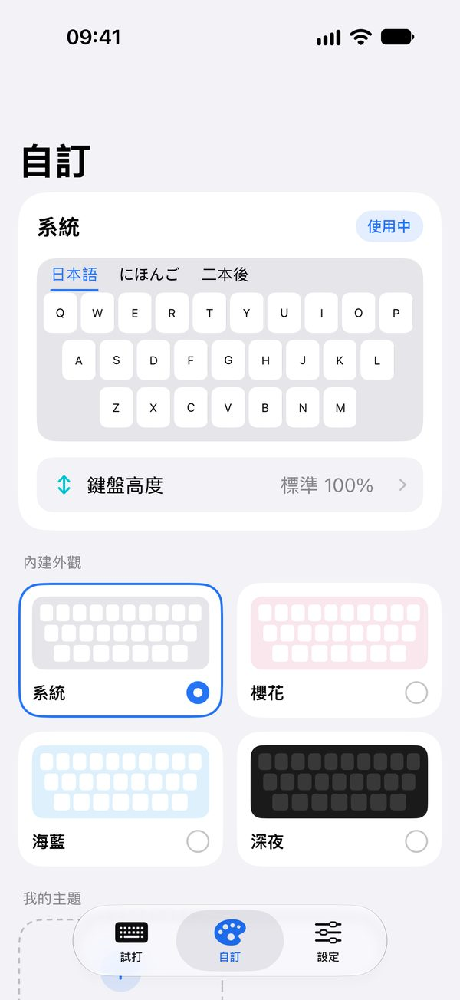

# Vime

完全離線的 iOS 多語言輸入法

<a href="../../README.md">简体中文</a> · <b>繁體中文</b> · <a href="README.en.md">English</a> · <a href="README.ja.md">日本語</a> · <a href="README.ko.md">한국어</a>

日文、中文、英文，一個鍵盤就夠。候選排序、糾錯和聯想都由裝置上的模型完成，輸入內容不離開你的手機。

  
  
  

## 功能

- **日文**：羅馬字或假名九宮格，整句與分段轉換、即時轉換；用漢語拼音也能查到日文漢字詞。
- **中文**：基於 librime 的拼音輸入，支援整句、簡拼、模糊音和拼音糾錯，可切換簡繁。
- **英文**：直接輸入，帶單字補全；上滑語言鍵即可在各語言之間切換。
- **本機語言模型**：日文和中文各有一個小型模型，結合上文為候選排序並提供聯想。
- **實用工具**：使用者詞典、剪貼簿建議、數字頁計算，以及符號、Emoji 和顏文字面板。
- **個人化**：多種外觀和自製主題，鍵盤高度、按鍵聲音和震動都可以調整。

## 隱私

轉換、糾錯、學習和聯想都在本機完成，Vime 不包含連網程式碼，不會上傳輸入內容或剪貼簿。基本輸入不需要「允許完整取用」。詳見 [隱私權政策](../../Docs/Guides/Privacy.zh-Hant.md)。

## 從原始碼建置

需要 iOS 18 或更新版本，以及支援目前 SDK 的 Xcode。用 Xcode 開啟 [Vime.xcodeproj](../../Vime.xcodeproj)，選擇 `Vime` scheme；在實機上執行前，為主 App 和 `VimeKeyboard` 延伸功能設定簽署和相同的 App Group。建置、測試和發布流程請見 [開發與驗證](../../Docs/Development.md)。

## 文件

使用指南、架構說明和開發流程請見 [文件索引](../../Docs/README.md)。

## 授權與致謝

Vime 以 [GPL-3.0-or-later](../../LICENSE) 授權發布，並依 GPLv3 第 7 條附加一項額外許可，允許在 App Store 等應用程式商店散布，條件是同時提供對應的原始碼，請見 [LICENSE-EXCEPTION](../../LICENSE-EXCEPTION)。2026-10-22 之前的版本仍以 GPL-2.0-only 發布。隨附的 [VimeML](https://github.com/Voltline/VimeML) 日語模型採用相同授權，訓練語料的署名請見第三方聲明。假名漢字轉換使用 [AzooKeyKanaKanjiConverter](https://github.com/azooKey/AzooKeyKanaKanjiConverter)，分詞使用 [SentencePiece](https://github.com/google/sentencepiece)。中文輸入使用 [librime](https://github.com/rime/librime) 和 [OpenCC](https://github.com/BYVoid/OpenCC)，拼音詞庫含 CC BY-SA 4.0 資料，並以相同授權發布。第三方程式碼與資料的授權、致謝和來源請見 [ThirdPartyNotices.txt](../../Shared/Resources/ThirdPartyNotices.txt)、[SentencePiece LICENSE](../../Dependencies/VimeSentencePiece/LICENSE) 和 [語言資源來源清單](../../Shared/Resources/LanguageResourceSources.json)，App 內「設定 → 關於 Vime → 開放原始碼元件與授權」也可檢視完整原文。
