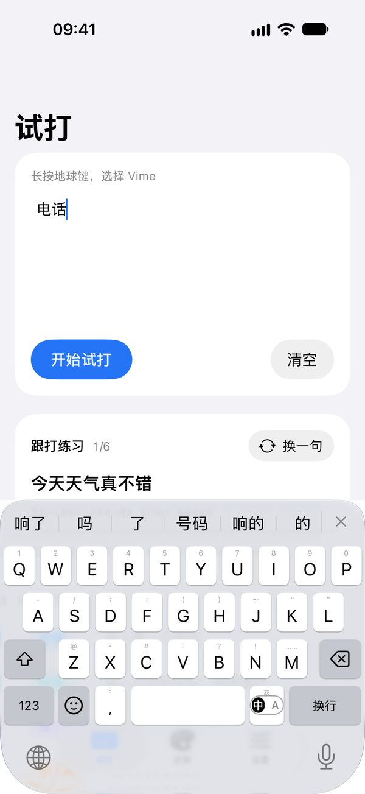
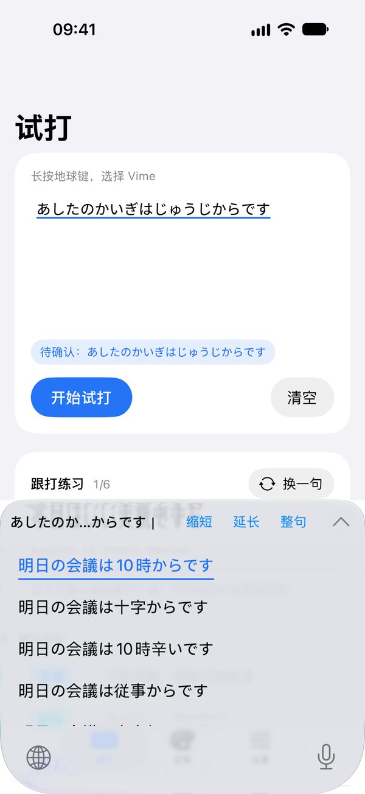
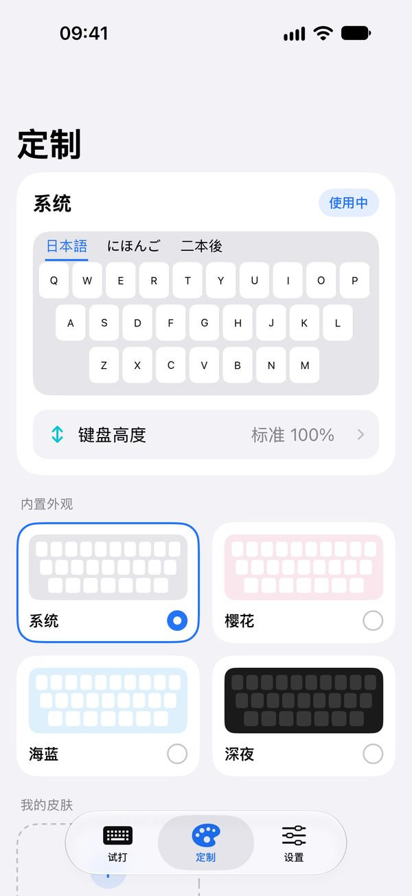

# Vime

完全离线的 iOS 多语言输入法

<b>简体中文</b> · <a href="Docs/i18n/README.zh-Hant.md">繁體中文</a> · <a href="Docs/i18n/README.en.md">English</a> · <a href="Docs/i18n/README.ja.md">日本語</a> · <a href="Docs/i18n/README.ko.md">한국어</a>

日语、中文、英文，一个键盘就够。候选排序、纠错和联想都由设备上的模型完成，输入内容不离开你的手机。

  
  
  

## 功能

- **日语**：罗马字或假名九宫格，整句与分段转换、实时转换；按汉语拼音也能查到日语汉字词。
- **中文**：基于 librime 的拼音输入，支持整句、简拼、模糊音和拼音纠错，可切换简繁。
- **英文**：直接输入，带单词补全；上滑语言键即可在各语言之间切换。
- **本机语言模型**：日语和中文各有一个小型模型，结合上文为候选排序并给出联想。
- **实用工具**：用户词典、剪贴板建议、数字页计算，以及符号、Emoji 和颜文字面板。
- **个性化**：多种外观和自制皮肤，键盘高度、按键声音和振动都可以调节。

## 隐私

转换、纠错、学习和联想都在本机完成，Vime 不包含联网代码，不上传输入内容或剪贴板。基本输入不需要「允许完全访问」。详见 [隐私政策](Docs/Guides/Privacy.md)。

## 从源码构建

需要 iOS 18 或更高版本，以及支持当前 SDK 的 Xcode。用 Xcode 打开 [Vime.xcodeproj](Vime.xcodeproj)，选择 `Vime` scheme；在真机上运行前，为主 App 和 `VimeKeyboard` 扩展配置签名和相同的 App Group。构建、测试和发布流程见 [开发与验证](Docs/Development.md)。

## 文档

使用指南、架构说明和开发流程见 [文档索引](Docs/README.md)。

## 许可与致谢

Vime 以 [GPL-3.0-or-later](LICENSE) 许可发布，并依 GPLv3 第 7 条附加一项额外许可，允许在 App Store 等应用商店分发，条件是同时提供对应源代码，见 [LICENSE-EXCEPTION](LICENSE-EXCEPTION)。2026-10-22 之前的版本仍以 GPL-2.0-only 发布。随附的 [VimeML](https://github.com/Voltline/VimeML) 日语模型采用相同许可，训练语料的署名见第三方声明。假名汉字转换使用 [AzooKeyKanaKanjiConverter](https://github.com/azooKey/AzooKeyKanaKanjiConverter)，分词使用 [SentencePiece](https://github.com/google/sentencepiece)。中文输入使用 [librime](https://github.com/rime/librime) 和 [OpenCC](https://github.com/BYVoid/OpenCC)，拼音词库含 CC BY-SA 4.0 数据，并以同一许可分发。第三方代码与数据的许可、致谢和来源见 [ThirdPartyNotices.txt](Shared/Resources/ThirdPartyNotices.txt)、[SentencePiece LICENSE](Dependencies/VimeSentencePiece/LICENSE) 和 [语言资源来源清单](Shared/Resources/LanguageResourceSources.json)，App 内「设置 → 关于 Vime → 开源组件与许可」也可查看完整原文。
